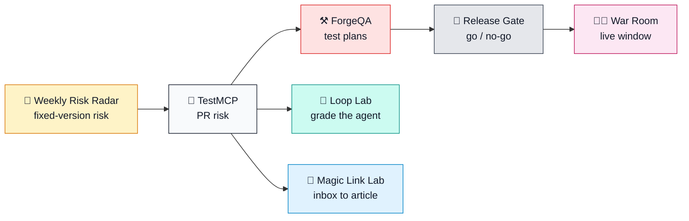

<p align="center">
  <a href="https://www.linkedin.com/in/analyticsrb">
    
  </a>
  <a href="https://github.com/ramonacraft">
    
  </a>
  <a href="#-what-i-build-in-public">
    
  </a>
</p>

---

## 👩‍💻 About Me

**Hi, I'm Ramona.** I'm learning to build in public with AI. These labs are how I think about release risk, go/no-go, and keeping humans on judgment.

```python
class RamonaCraft:
    def __init__(self):
        self.name = "Ramona Bonitatis"
        self.role = "Building in public"
        self.focus = "Release risk · Go / no-go · AI-assisted quality"
        self.location = "North Los Angeles 🌴"
        self.platforms = ["Web", "iOS", "Android", "CTV"]

    def skills(self):
        return {
            "day_to_day": ["Cursor", "Claude", "GitHub", "MCP", "Jira"],
            "building": ["Weekly Risk Radar", "TestMCP", "ForgeQA", "Release Gate Lab", "War Room", "Loop Lab", "Magic Link Lab"],
            "learning": ["Databricks", "Prompt evals", "LangGraph"],
        }

    def how_i_work(self):
        return [
            "Automate the rinse-and-repeat",
            "Keep humans on edge cases + judgment",
            "Lead with visuals so teams align fast",
            "Ship small labs, learn in public",
        ]
```

<p align="center">
  
</p>

### 🎯 Quick Snapshot

<table>
  <tr>
    <td>📍</td>
    <td><b>Based in</b></td>
    <td>North Los Angeles</td>
  </tr>
  <tr>
    <td>💼</td>
    <td><b>Focus</b></td>
    <td>Building in public · release risk · go/no-go · AI-assisted quality</td>
  </tr>
  <tr>
    <td>📈</td>
    <td><b>In public</b></td>
    <td>7 labs · live demos · learning as I go</td>
  </tr>
  <tr>
    <td>🔥</td>
    <td><b>Building with</b></td>
    <td>Cursor, Claude, GitHub, MCP, Jira</td>
  </tr>
  <tr>
    <td>🌱</td>
    <td><b>Learning next</b></td>
    <td>Databricks, prompt eval frameworks, LangGraph</td>
  </tr>
  <tr>
    <td>💡</td>
    <td><b>Philosophy</b></td>
    <td>Automate the rinse-and-repeat. Keep humans on judgment.</td>
  </tr>
  <tr>
    <td>🤝</td>
    <td><b>Here to</b></td>
    <td>Ship small, show the work, get better in public</td>
  </tr>
</table>

<p align="center">
  <i>"Still learning. Shipping small. Having fun with it."</i>
</p>

---

## 🚀 What I build in public

Practice projects around release readiness, live windows, and AI-assisted quality. The point is to show how I think, not to look like a finished product org.

| | Project | What it is |
|:--:|:--|:--|
| 📡 | **[Weekly Risk Radar](https://github.com/ramonacraft/weekly-risk-radar)** | Weekly app-release conductor — six platforms, P0–P2 (manual) aim, stakeholder go pack · [live demo](https://weekly-risk-radar.vercel.app/) |
| 👩‍💻 | **[Live Event War Room](https://github.com/ramonacraft/live-event-war-room)** | Live-event ops board + living runbook (real signals + Healthy → Incident) |
| 🚦 | **[Release Gate Lab](https://github.com/ramonacraft/release-gate-lab)** | Lean go/no-go dashboard for release decisions · [live demo](https://release-gate-lab.vercel.app/) |
| 🧪 | **[TestMCP](https://github.com/ramonacraft/testmcp)** | PR changes → risk-ranked P0–P3 test plan (MCP + dashboard) |
| ⚒️ | **[ForgeQA](https://github.com/ramonacraft/forgeqa)** | Plain-English goals to reviewable test plans |
| 🔁 | **[Loop Lab](https://github.com/ramonacraft/loop-lab)** | Draft, score, retry, then pass or escalate — I QA the agents that QA the release · [live demo](https://loop-lab-loops.vercel.app/) |
| 🔗 | **[Magic Link Lab](https://github.com/ramonacraft/magic-link-lab)** | Same eval loop for the gated-article path — web, iOS, and Android each need their own login |

## 🔀 How the work connects



`Weekly release risk → PR risk → test plans → go/no-go → live window view. Loop Lab grades the password path. Magic Link Lab grades inbox-to-article.`

---

## 🏆 What I'm practicing

Public labs, not a work resume. This table will grow as I ship.

| Lab | What I'm practicing |
|:--|:--|
| **Weekly Risk Radar** | One fixed version, many pillars, a stakeholder go pack |
| **Release Gate Lab** | A lean go/no-go board people can actually read |
| **Loop Lab** | Who grades the AI before it grades the release |
| **TestMCP + ForgeQA** | Change → what to verify → a reviewable plan |
| **War Room** | Live windows and a runbook that stays current |

---

## 🛠️ Tech Stack & Tools

<div align="center">

### ✅ Working with now

<p>
  
  
  
  
  
  
</p>

### 🌱 Learning next

<p>
  
  
  
</p>

Inspired by **Andrew Ng** and DeepLearning.AI — practical AI systems, evals, and building with judgment, not hype.

</div>

---

## 💡 How I Work

| | |
|:--|:--|
| 🔁 **Automate the repeat** | Keep humans on edge cases, validating AI agent work, and release judgment. |
| 🎯 **Trusted suites** | Prefer small P0–P3 suites over giant suites that quietly get deprioritized. |
| 📊 **Fresh priorities** | Map work to what matters, not only ticket volume. |
| 🎨 **Visual first** | Boards, flows, and dashboards over long walls of text. |
| 📚 **Always learning** | New skills and tools, then put them to work. Prompt less. Show the work. |

## ✨ Currently

- 🔗 Shipping **[Magic Link Lab](https://github.com/ramonacraft/magic-link-lab)** — same eval loop for inbox-to-article. Web, iOS, and Android each need their own login
- 🔁 Shipping **[Loop Lab](https://loop-lab-loops.vercel.app/)** — draft, score, retry, then pass or escalate. The missing piece: who grades the AI
- 📡 Shipping **[Weekly Risk Radar](https://weekly-risk-radar.vercel.app/)** — the weekly app-release conductor that ties the portfolio loop together
- 🚦 Keeping the delivery loop public — [Release Gate live demo](https://release-gate-lab.vercel.app/) sits in **risk → test plans → go/no-go → live window**
- 👩‍💻 Building portfolio labs that mirror real release and live-ops decisions (War Room, TestMCP, ForgeQA)
- 🧠 Learning hands-on with a local second brain (search by meaning + Claude) so the AI tools I recommend are ones I've actually run
